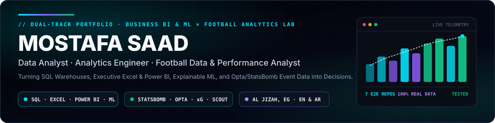
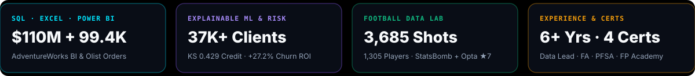

  

    

  <!-- Quick Navigation & Contact Bar -->
  
  
  
  
  
  
  
  

    

  <!-- Verified Impact Scorecard (Zero External API Failure!) -->
  

---

## About Me

I'm **Mostafa Saad** — a **Data Analyst & Analytics Engineer** with **6+ years of experience** operating across two specialized domains:

- **📊 Business Data, BI & Applied ML:** Relational SQL warehousing (`SQL Server` / `SQLite` Star Schema), boardroom `Excel` (`Power Query`, `What-If Simulators`) & `Power BI` (`PBIP`, `DAX`), statistical testing, and zero-leakage explainable machine learning (`LightGBM`, `XGBoost`, `SHAP`, `ROI optimization`, `Time-Series Forecasting`).
- **⚽ Football Data & Performance Analytics:** Turning `Opta / WhoScored` and official `StatsBomb Open Data` (360 Freeze-Frames) into calibrated `xG / xT` models, automated post-match PDF reports, AMOLED 4:5 tactical posters, and recruitment similarity engines — backed by **The FA**, **PFSA**, **FP Academy**, and **England Football** training.
- **🌍 Bilingual Delivery:** All dashboards, models, and project engineering stories (`PROJECT_STORY.md`) are built for executive clarity in **English & Arabic**.

---

## 📊 Track 01 — Business Data, BI & Machine Learning (100% Real Data)

| Flagship Repository | Real Dataset | Stack | Verified Impact & Live Links |
|---|---|---|---|
| **[uk-retail-clv-survival-engine](https://github.com/mostafasaad91/uk-retail-clv-survival-engine)** *1.067M-Row CLV, Survival & Market Basket Engine* | **1,067,371 rows** 2 native Excel sheets (`£17.07M GMV`) | `Multi-Sheet Excel` · `SQL Star Schema` · `Stacking + SHAP` · `Survival & SVD` · `CI ✅` | **0.7979** out-of-time AUC · **73.22%** Top-20% CLV capture · **89.4%** 12M survival · **31.6x** basket lift · **13.78% MAPE** · [▶ Live 4-Page Dashboard](https://mostafasaad91.github.io/uk-retail-clv-survival-engine/) · [⬇ 8-Sheet Excel](https://github.com/mostafasaad91/uk-retail-clv-survival-engine/raw/main/outputs/Retail_1M_DataScience_Executive_Workbook.xlsx) |
| **[olist-supply-chain-sla-forecasting](https://github.com/mostafasaad91/olist-supply-chain-sla-forecasting)** *Full-Stack Centerpiece (SQL + Excel + Python + DS)* | **99,441 real orders** 8 relational tables (`R$15.29M GMV`) | `SQL Star Schema` · `6-Sheet Excel` · `LightGBM` · `SHAP` · `CI ✅` | **5.88x** late-delivery risk (`p<1e-300`) · **+45.4%** CS ROI · **3.50% MAPE** · [▶ Live 4-Page Dashboard](https://mostafasaad91.github.io/olist-supply-chain-sla-forecasting/) · [⬇ Excel](https://github.com/mostafasaad91/olist-supply-chain-sla-forecasting/raw/main/outputs/Olist_Executive_Analytics_Workbook.xlsx) |
| **[adventure-works-sales-analytics](https://github.com/mostafasaad91/adventure-works-sales-analytics)** `★ 1` *Enterprise SQL → Python → Power BI* | **$110M OLTP DB** 72 tables · `121K` sales lines | `T-SQL` · `pyodbc` · `K-Means RFM` · `Power BI (PBIP)` · `17 DAX` | Point-in-time margins · `k=4` SQL write-back · **>90x** basket lift · [▶ Live 6-Page Power BI](https://app.powerbi.com/view?r=eyJrIjoiODk5NTM5YjQtMTk4Ny00NGU2LWFiMzUtYTg1N2YwZDUyYWU4IiwidCI6ImI3YTMxZDI1LWYyMzMtNGM4ZC05ODM0LTdiMjVlZDVlMWU4YSIsImMiOjh9) |
| **[fintech-credit-risk-scorecard](https://github.com/mostafasaad91/fintech-credit-risk-scorecard)** *Credit Scoring & Basel III Expected Loss* | **30,000 bank clients** UCI Credit Default (`22.1%` default) | `SQLite` · `WoE/IV` · `LightGBM` · `Basel EL` · `CI ✅` | **KS 0.429 · Gini 0.564 · Brier 0.134** · 300–850 score · **NT$29.6M** Basel EL (top 20% = 50.9% defaults) · [Story](https://github.com/mostafasaad91/fintech-credit-risk-scorecard/blob/main/docs/PROJECT_STORY.md) |
| **[telco-churn-retention-roi](https://github.com/mostafasaad91/telco-churn-retention-roi)** *Explainable Churn & Retention ROI* | **7,043 subscribers** IBM Telco (`26.5%` churn) | `SQLite` · `XGBoost` · `Calibration` · `SHAP` · `CI ✅` | **0.848 Test ROC-AUC** (`Brier 0.135`) · Val threshold `0.37` lifts test net profit **+27.2%** (`$40.5K vs $31.8K`) · [Story](https://github.com/mostafasaad91/telco-churn-retention-roi/blob/main/docs/PROJECT_STORY.md) |

---

## ⚽ Track 02 — Football Data & Performance Analytics Lab (Opta & StatsBomb)

| Flagship Repository | Real Dataset | Stack | Verified Impact & Live Links |
|---|---|---|---|
| **[Football-Match-Analysis](https://github.com/mostafasaad91/Football-Match-Analysis)** `★ 7` *Automated Post-Match Tactical Engine* | **WhoScored / Opta** EPL · La Liga · Serie A | `Python` · `xG / xT / xGChain` · `PPDA` · `SQLite` · `PDF` | **1 URL → Full Package:** 8 dual AMOLED (`#000000`) & Print (`#F5F5F5`) 4:5 posters, PDF report, `.docx` article & SQLite archive |
| **[statsbomb-360-xg-calibration](https://github.com/mostafasaad91/statsbomb-360-xg-calibration)** *Freeze-Frame xG Calibration Benchmark* | **3,685 real shots** 149 matches (WC22 · Euro24 · BL23/24) | `StatsBomb 360` · `Match-Grouped CV` · `SHAP` · `CI ✅` | Freeze-Frame cuts Log-Loss **-0.0236** (`0.2531` LL / `0.816` AUC vs official StatsBomb `0.2422` / `0.827`) · [▶ Live 3,642-Shot Explorer](https://mostafasaad91.github.io/statsbomb-360-xg-calibration/) |
| **[football-scouting-similarity-engine](https://github.com/mostafasaad91/football-scouting-similarity-engine)** *Tactical Role Discovery & Recruitment ML* | **1,305 real players** 361 eligible (`270+ min` gate) | `SQLite` · `Silhouette K-Means` · `PCA` · `Cosine` · `CI ✅` | Optimal `k=4` · `56.3%` PCA · **Wirtz → Yamal (96%)** · **Xhaka → Vitinha (92%)** · [▶ Live Twin Finder](https://mostafasaad91.github.io/?track=football#scouting-widget) |

---

## 🎨 Visual Proof Gallery (AMOLED Outputs from Live Repos)

<table>
  <tr>
    <td width="50%" align="center">
      
      <b>1.067M Retail CLV & Data Science Engine</b> · Top 20% VIPs = 73.22% of 90d Revenue
    </td>
    <td width="50%" align="center">
      
      <b>1.067M Retail Survival & Cohorts</b> · 89.4% Loyal vs 25.2% One-Time 12M Survival
    </td>
  </tr>
  <tr>
    <td width="50%" align="center">
      
      <b>Olist Full-Stack (SQL + Excel + ML)</b> · Late Delivery 5.88x Bad-Review Cliff
    </td>
    <td width="50%" align="center">
      
      <b>FinTech Credit Risk Scorecard</b> · KS 0.429 · Gini 0.564 · 30K Bank Clients
    </td>
  </tr>
  <tr>
    <td width="50%" align="center">
      
      <b>StatsBomb 360 xG Calibration</b> · Freeze-Frame Ablation vs Official StatsBomb xG
    </td>
    <td width="50%" align="center">
      
      <b>Scouting Similarity Engine</b> · Wirtz → Lamine Yamal (96%) · Xhaka → Vitinha (92%)
    </td>
  </tr>
</table>

---

## 🛠️ Core Technical Toolkit

**SQL & Data Engineering**
 
-CC2927?style=flat-square&logo=microsoftsqlserver&logoColor=white)

**Business Intelligence & Executive Reporting**
 
-F2C811?style=flat-square&logo=powerbi&logoColor=black)
-217346?style=flat-square&logo=microsoftexcel&logoColor=white)

**Python, Statistics & Machine Learning**
 

**Football Analytics & Tactical Scouting**
 

---

  

